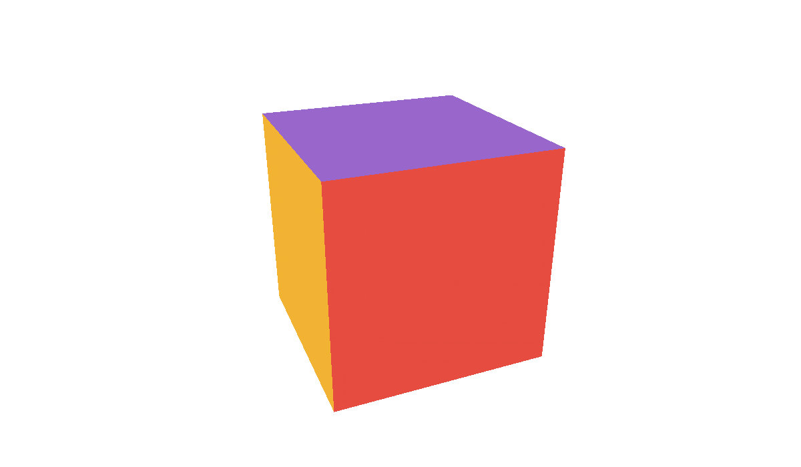

# A1 - Raw OpenGL 3.3: a turning cube



The smallest demo for a slide: a cube that turns by itself, in raw OpenGL 3.3, with no library
but GLFW. The slide sets it through the address of the iframe; there is no control on screen.

- **Graphics:** basic (one draw call, one color per face).
- **Interface:** none while it runs; a preset per slide in the address.

## In a slide

In reveal.js: [slides.html](slides.html), a frame on `web/index.html`. In lhtml-site: [lhtml-site/](lhtml-site/), the slide `src/01_rotating-cube/index.html.j2`, with the demo in `src/_demo/`:

```
demo::../_demo/index.html?speed=0.2&tilt=25
```

| Setting | Values | Default |
|---|---|---|
| `speed` | turns per second | `0.15` |
| `tilt` | degrees | `25` |
| `background` | `light`, `dark` | `light` |

## What to look at in `main.cpp`

One source for the desktop and the web. The differences, marked with `#ifdef __EMSCRIPTEN__`:

1. **Headers:** `GLES3/gl3.h` on the web, the glad loader on the desktop.
2. **First line of the shaders:** `#version 300 es` and a `precision` on the web, `#version 330 core` on the
   desktop. The body of the shaders is the same: the program prepends the right header.
3. **Size of the drawing surface:** the canvas, which the page sizes to the iframe; the window is created at
   that size, otherwise `glfwCreateWindow` resizes the canvas.
4. **Main loop:** the browser calls `frame()` at each refresh (`emscripten_set_main_loop`).

The settings are three lines, with the bridge:

```cpp
slide::parse(argc, argv);
slide::param("speed", speed, 0.0f, 1.0f, 0.01f);
slide::param("tilt", tilt, -90.0f, 90.0f, 1.0f);
slide::param("background", background, {"light", "dark"});
```

## Build

```sh
# desktop (GLFW installed: brew install glfw, or apt install libglfw3-dev)
cmake -S . -B build && cmake --build build && ./build/project --speed 0.3

# web (Emscripten SDK active)
emcmake cmake -S . -B build_web && cmake --build build_web
```

The web build gives `index.html`, `project.js` and `project.wasm` in `build_web/`, and copies them into
[web/](web/) and `lhtml-site/src/_demo/`: both slides then show the new version (to keep `web/` as it is:
`-DSLIDE_DEMO_PUBLISH=OFF`). Serve the folder with a web server (`python3 -m http.server`), not as a file.
