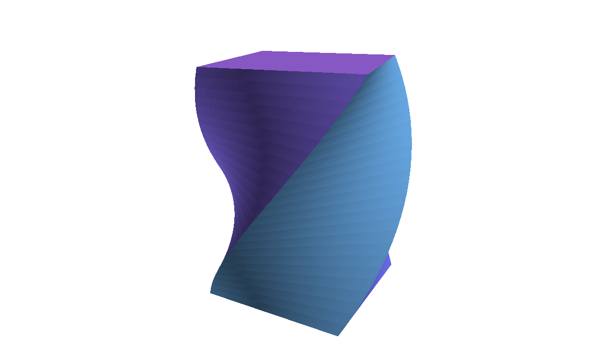

# Example 2 (A2): Uniforms driven live

*raw OpenGL 3.3, uniforms driven live. The page of the tutorial: [2. Uniforms driven live](https://scholartools.fr/interactive-3d-slides/01_tutorial/03_panel/index.html).*



The cube of [A1](../a1-opengl-cube/), changed while it runs: a twist computed in the vertex shader,
a hue, the light on or off, the speed, and a reset button. The panel is built by the page from the
parameters the program declares: there is no HTML to write.

- **Graphics:** basic (a subdivided box, a deformation in the vertex shader, lighting without normals).
- **Interface:** a panel of sliders and buttons in the iframe, or controls in the slide (postMessage).

## In a slide

In reveal.js: [slides.html](slides.html), a frame on `web/index.html`. In lhtml-site: [lhtml-site/](lhtml-site/), the slide `src/01_uniforms/index.html.j2`, with the demo in `src/_demo/`:

```
demo::../_demo/index.html?twist=0.8&controls=twist,hue,speed,light,reset
```

| Setting | Values | Default |
|---|---|---|
| `twist` | radians per unit of height, `-3` to `3` | `0` |
| `hue` | `0` to `1` | `0.58` |
| `speed` | turns per second | `0.15` |
| `light` | `0`, `1` | `1` |
| `background` | `light`, `dark` | `light` |
| `reset` | button | |

`controls=` chooses the controls of the panel and their order; add `&compact=1` for a small panel and
`&panel=bl` to put it in the bottom left corner.

From the slide, without the panel:

```js
document.querySelector('iframe').contentWindow.postMessage({slide: {set: {twist: 2, hue: 0.05}}}, '*');
```

## What changes from A1

- **Declared parameters:** each one once, with its range; the panel and `postMessage` go through them.

  ```cpp
  slide::param("twist", twist, -3.0f, 3.0f, 0.05f).with_label("twist (rad/unit)", "twist");
  slide::param("light", light);
  slide::action("reset", [] { speed = 0.15f; twist = 0.0f; hue = 0.58f; light = true; angle = 0.0f; });
  ```

- **Uniforms sent at each frame:** the program only reads its variables; it does not need to know that
  they were changed.
- **An accumulated angle:** `angle += 2 pi speed dt`, so that a change of speed does not make the box jump
  (A1 computes the angle from the time, which jumps when the speed changes).
- **A subdivided box:** the twist bends the faces, which needs vertices inside them.
- **Lighting without normals:** the fragment shader takes the normal from the derivatives of the position
  (`cross(dFdx(p), dFdy(p))`). Each triangle is flat, which shows as thin bands on the twisted faces.

## Build

As [example 1 (A1)](../a1-opengl-cube/README.md#build).
