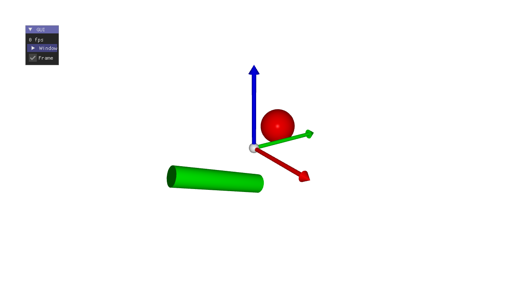

# C1 - The CGP template, as is



Your CGP program already works in a slide: this example is the template project of CGP, compiled for
the web without changing a line, and shown with the page of the bridge. The mouse turns the camera,
the ImGui window of the template stays on screen, and the arrow keys still go to the slides.

- **Graphics:** basic (the scene of the template: a sphere, a turning cylinder, the frame).
- **Interface:** the mouse in the canvas (orbit camera) and the ImGui window of the template.

There is no file of its own here: [scripts/build_examples.py](../../scripts/build_examples.py) copies the
template project of CGP (`CGP_DIR`), adds the two files of the bridge to `src/`, and builds it with the
`CMakeLists.txt` of CGP.

## In a slide

In reveal.js: [slides.html](slides.html), a frame on `web/index.html`. In lhtml-site: [lhtml-site/](lhtml-site/), the slide `src/01_cgp-template/index.html.j2`, with the demo in `src/_demo/`:

```
demo::../_demo/index.html
```

## What the page adds to a CGP build

The web build of CGP gives `project.html/.js/.wasm/.data`. For a slide, replace `project.html` (or the
`index.html` of the template) by [bridge/slide-frame.html](../../bridge/slide-frame.html) as `index.html`:

- the canvas fills the iframe, whatever the size of the window created by the program;
- the arrow keys and Page Up/Down go to the slides, even after a click in the demo;
- the demo fades in once its first frames are drawn, and the PDF export of lhtml-site waits for them;
- the canvas keeps its image, so that it can be captured (PDF, tests).

To set the demo from the address of the slide, or to drive it live, see [C3](../c3-cgp-waving-surface/).

## Build

```sh
# from the root of the repository (or of the unzipped folder), the Emscripten SDK active
source <emsdk>/emsdk_env.sh
git clone https://github.com/drohmer/cgp-2027.git ../cgp-2027     # the CGP project, once
CGP_DIR=../cgp-2027 python3 scripts/build_examples.py c1-cgp-template
```

The build replaces [web/](web/) and `lhtml-site/src/_demo/`: both slides then show the new version.
Serve the folder with a web server (`python3 -m http.server`), not as a file.
