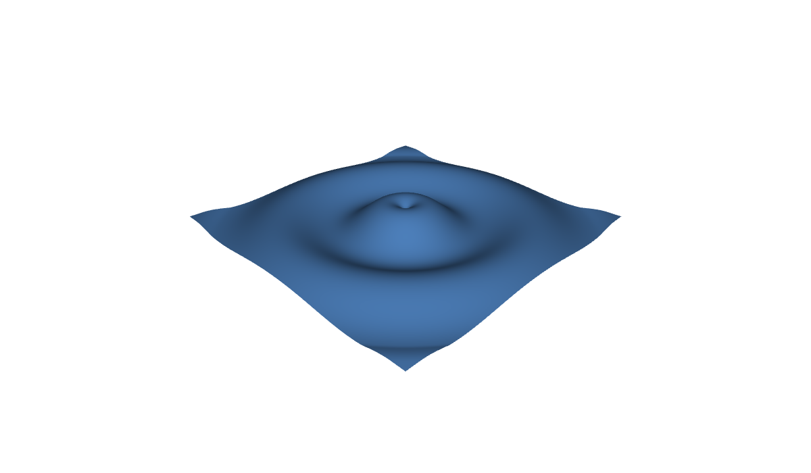

# C3 - CGP: a waving surface, driven from the panel and from the slide



A grid of 120 x 120 vertices moved at each frame: a ripple from the center, or parallel waves. You change
it while you speak, in two ways at once:

- **a panel in the demo**, built by the page from the parameters declared in C++;
- **buttons in the text of the slide**, outside the demo, written in HTML with `slide-controls.js`.

The ImGui window of the template changes the same variables (`?gui=1`).

- **Graphics:** intermediate (a mesh updated on the CPU at each frame, its normals, a wireframe in segments).
- **Interface:** a panel in the iframe, controls in the slide, the mouse in the canvas.

## In a slide

In reveal.js: [slides.html](slides.html), a frame on `web/index.html`. In lhtml-site: [lhtml-site/](lhtml-site/), the slide `src/01_waving-surface/index.html.j2`, with the demo in `src/_demo/`:

```
demo::../_demo/index.html?controls=ampl,k,speed,damping,wireframe,play&compact=1&panel=bl
```

Buttons in the slide, under the demo (`slide-controls.js` is loaded by `slides.html`, and by the
`configure.yaml` of `lhtml-site/`):

```html
<button data-demo-set="shape=ripple">Ripple</button>
<button data-demo-set="shape=waves">Waves</button>
<button data-demo-set="drop">Drop</button>
<button data-demo-set="ampl=0.25&k=14">Strong</button>
A = <span data-demo-value="ampl" data-digits="2"></span>
```

A button gets the class `on` while its settings are the current values of the demo (style it in the
slide: `button.on { background: #333; color: white; }`); a `data-demo-value` shows a value live.

| Setting | Values | Default |
|---|---|---|
| `ampl` | amplitude, `0` to `0.3` | `0.12` |
| `k` | wave number, `2` to `20` | `9` |
| `speed` | angular speed, `0` to `10` | `4` |
| `damping` | decay with the distance, `0` to `4` | `1` |
| `shape` | `ripple`, `waves` | `ripple` |
| `wireframe`, `play`, `gui` | `0`, `1` | `0`, `1`, `0` |
| `drop` | button: a new ripple from the center | |

## What changes from the CGP template

Three files of `src/` replace those of the template:

- **`main.cpp`:** one line, `slide::parse(argc, argv);`, to keep the arguments given by the address.
- **`scene.hpp`:** the parameters of the wave, in one structure.
- **`scene.cpp`:** the parameters declared once in `initialize()`,

  ```cpp
  slide::param("ampl", wave.amplitude, 0.0f, 0.3f, 0.01f).with_label("amplitude", "<i>A</i>");
  slide::param("shape", wave.shape, {{"ripple", "Ripple"}, {"waves", "Waves"}}).on_change([this] { t = 0; });
  slide::action("drop", [this] { t = 0; wave.shape = "ripple"; });
  ```

  and the vertices moved at each frame, as in the How-to *Update a mesh every frame* of CGP.

The template always draws its ImGui window. In a slide, the page has its own panel: `display_gui()` hides
the window (collapsed, out of sight and transparent: ImGui keeps a corner of a window on screen) unless `gui=1`.

## A trap of the web: no wireframe with `draw_wireframe`

`draw_wireframe()` of CGP uses `glPolygonMode`, which does not exist in WebGL: on the web it draws nothing,
without an error. The wireframe here is a `curve_drawable` of segments (`GL_LINES`, which WebGL has): one grid
line out of 6, updated at each frame with the surface, and drawn the same way on the desktop and on the web.
The browser test of the example caught it (the image did not change when the wireframe was turned on).

## Build

```sh
# from the root of the repository (or of the unzipped folder), the Emscripten SDK active
source <emsdk>/emsdk_env.sh
git clone https://github.com/drohmer/cgp-2027.git ../cgp-2027     # the CGP project, once
CGP_DIR=../cgp-2027 python3 scripts/build_examples.py c3-cgp-waving-surface
```

The build replaces [web/](web/) and `lhtml-site/src/_demo/`: both slides then show the new version.
Serve the folder with a web server (`python3 -m http.server`), not as a file.
