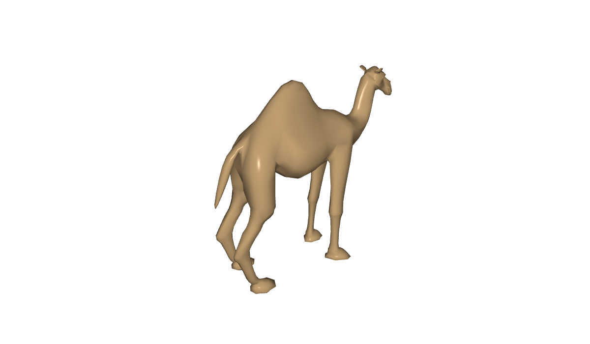

# Example 7 (C4): Models from files

*CGP, OBJ models loaded from files, with their materials and textures, chosen from the slide. The page of the
tutorial: [7. Models from files](https://scholartools.fr/interactive-3d-slides/02_examples/01_models/index.html).*



Two models, chosen by the buttons of the slide: a camel (a single OBJ file, without texture) and the atrium of
Sponza (an OBJ file, its materials `sponza.mtl` and 12 textures). The slide shows the number of triangles of the
model shown.

- **Graphics:** meshes and textures read from files.
- **Interface:** buttons in the slide; a value sent to the slide; the mouse turns the camera.

## In a slide

In reveal.js: [slides.html](slides.html). In lhtml-site: [lhtml-site/](lhtml-site/), the slide
`src/01_models/index.html.j2`, with the demo in `src/_demo/`:

```
demo::../_demo/index.html?controls=turn&panel=bl
```

| Setting | Values | Default |
|---|---|---|
| `model` | `camel`, `sponza` | `camel` |
| `turn` | the camel turns by itself | `1` |
| `triangles` | the number of triangles of the model shown (read only) | |

## Files in a demo for the web

- The files of `assets/` are read with the same paths as on the desktop (`project::path + "assets/..."`). For
  the web, the `CMakeLists.txt` of CGP packs this folder into `project.data` (`--preload-file`), downloaded
  with the demo before it starts.
- `project.data` is about 3 MB here: keep the files small (meshes simplified, images of 512 pixels or less),
  the demo is downloaded at the first display of its slide.
- The file system of the browser is case-sensitive: the names in `sponza.mtl` must be those of the files,
  exactly (see [assets/sponza/origin.txt](assets/sponza/origin.txt)).
- Reading the OBJ file of Sponza takes a few seconds: the program reads it the first time it is shown
  (`load_sponza()`), so that the camel appears without waiting.

## Build

```sh
# from the root of the repository (or of the unzipped folder), the Emscripten SDK active
source <emsdk>/emsdk_env.sh
git clone https://github.com/drohmer/cgp-2027.git ../cgp-2027     # the CGP project, once
CGP_DIR=../cgp-2027 python3 scripts/build_examples.py c4-cgp-load-obj
```

The build replaces [web/](web/) and `lhtml-site/src/_demo/`: both slides then show the new version.
Serve the root of the repository (or of the unzipped folder) with a web server, not as a file:
`python3 -m http.server 8080`, then open `http://localhost:8080/examples/c4-cgp-load-obj/slides.html`.

## Credits

The camel comes from github.com/drohmer/csc43043ep-lab-code. Sponza: modeled by Marko Dabrovic, see
[assets/sponza/copyright.txt](assets/sponza/copyright.txt).
