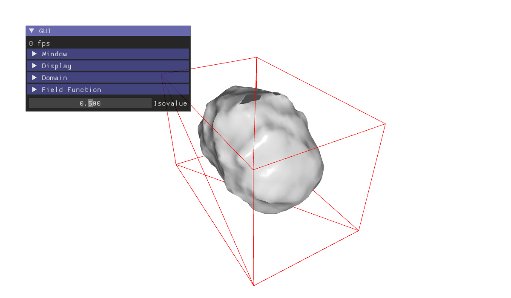

# C6 - CGP: interactive marching cubes, with ImGui



An implicit surface, a sum of blobs and Perlin noise, meshed by marching cubes each time a parameter
changes. The interface is the ImGui window of the program, the quickest one to write: no HTML, and
every setting of the field at hand. In a slide, the page makes it readable, and the slide can drive
the same variables.

- **Graphics:** advanced (a scalar field on a grid, marching cubes, recomputed live).
- **Interface:** ImGui in the canvas, enlarged for the projector; the slide may also drive it.

The code comes from the CGP example of
[epita_ani3d_lab_code-2027](https://github.com/drohmer/epita_ani3d_lab_code-2027)
(`examples/02_marching_cubes/02_marching_cube_dynamic`), as in the documentation of CGP.

## In a slide

```
demo::../../_demo/c6/index.html?gui_scale=1.4
```

| Setting | Values | Default |
|---|---|---|
| `gui_scale` | size of the text of ImGui, `0.5` to `3` | `1` |
| `isovalue` | `0` to `1` | `0.5` |
| `power_c` | magnitude of the third blob, `0` to `2` | `0` |
| `noise` | magnitude of the noise, `0` to `1` | `0` |
| `samples` | grid samples per side, `8` to `100` | `30` |
| `domain` | the box of the domain, `0`, `1` | `1` |

From the slide, with [slide-controls.js](../../bridge/slide-controls.js):

```html
<button data-demo-set="power_c=1.2">Third blob</button>
<button data-demo-set="isovalue=0.3">Larger</button>
```

The ImGui window shows the new values at the next frame: it reads the variables of the program.

## What changes from the original example

- **`main.cpp`:** one line, `slide::parse(argc, argv);`.
- **`scene.cpp`:** the variables of the ImGui window declared to the bridge, with what to recompute
  when the slide changes them:

  ```cpp
  slide::param("isovalue", gui.isovalue, 0.0f, 1.0f, 0.01f)
      .on_change([this] { implicit_surface.update_marching_cube(gui.isovalue); });
  slide::param("power_c", field_function.sc, 0.0f, 2.0f, 0.05f).on_change(refield);
  slide::param("gui_scale", project::gui_scale, 0.5f, 3.0f, 0.1f);
  ```

  and a camera farther away, so that the whole domain fits a wide slide.
- **`implicit_surface/gui_helper.cpp`:** two controls hidden on the web. The wireframe uses
  `glPolygonMode`, which WebGL does not have (see [C3](../c3-cgp-waving-surface/README.md)); the export of
  the mesh would write a file in the memory of the page.

## ImGui in a slide

- **Readable:** `gui_scale` enlarges the text and the widgets (`ImGui::GetIO().FontGlobalScale`, set by the
  template from `project::gui_scale` at each frame). Keep the sections closed at start: a long window goes
  out of the frame.
- **Mouse:** ImGui takes the clicks over its window; elsewhere, the mouse turns the camera.
- **Keys:** the arrows and Page Up/Down go to the slides, not to ImGui (slide-frame.html).
- **In the PDF:** the poster shows the window as it is at start.

## Build

```sh
source <emsdk>/emsdk_env.sh
CGP_DIR=<the CGP project> python3 scripts/build_examples.py c6-cgp-marching-cubes
```

[web/](web/) holds a built copy. Serve the folder with a web server, not as a file.
