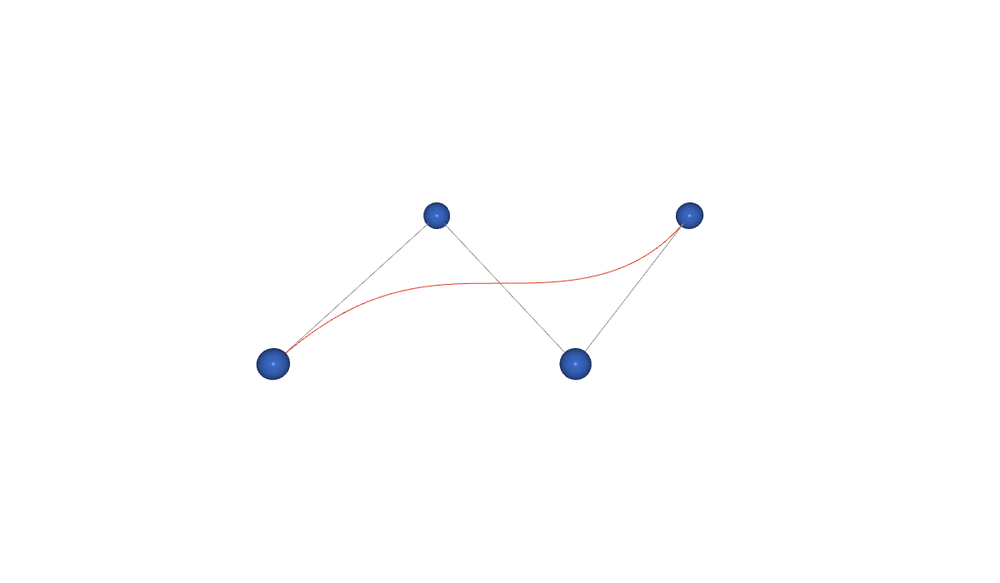

# C7 - CGP: select and drag the control points of a curve



The control points of a curve, dragged with the mouse: a Bezier curve, which approaches its points, or a
Catmull-Rom spline, which goes through them. The length of the curve is computed by the program and shown
in the slide while you drag: a value that goes from the demo to the slide.

- **Graphics:** intermediate (curves of any degree, de Casteljau, picking in 3D).
- **Interface:** direct manipulation in the canvas; buttons and a live value in the slide.

The picking comes from the How-to *Select and drag with the mouse* of the CGP documentation.

## In a slide

In reveal.js: [slides.html](slides.html), a frame on `web/index.html`. In lhtml-site: [lhtml-site/](lhtml-site/), the slide `src/01_drag-points/index.html.j2`, with the demo in `src/_demo/`:

```
demo::../_demo/index.html?controls=curve,points,polygon,reset,length&compact=1&panel=br
```

```html
<button data-demo-set="curve=bezier">Bezier</button>
<button data-demo-set="curve=spline">Spline</button>
length = <span data-demo-value="length" data-digits="2"></span>
```

| Setting | Values | Default |
|---|---|---|
| `curve` | `bezier`, `spline` | `bezier` |
| `points` | number of control points, `3` to `7` | `4` |
| `polygon` | the control polygon, `0`, `1` | `1` |
| `reset` | button: the points back to their places | |
| `length` | read only: length of the curve | |
| `gui` | the ImGui window of the template, `0`, `1` | `0` |

## A value from the program to the slide

The other examples send values from the slide to the program. Here the program changes values by itself:
the mouse moves the points, and the length follows. Two calls of the bridge:

```cpp
slide::readout("length", [this] { return length; });   // read only, shown by the page and the slide

// in display_frame(), once the curve is updated
if (std::abs(length - notified_length) > 1e-4f) {
    notified_length = length;
    slide::notify();   // the page shows the new values, and sends them to the slide
}
```

The page groups the notifications: at most one message a frame.

## Dragging with the mouse

- **Picking:** `picking_spheres` finds the point under the mouse at the click; while the button is down,
  the point follows the mouse in the plane facing the camera (`picking_plane_orthogonal_to_camera`), and
  the camera stays still (`camera_control.is_active = false`).
- **Lines of 1 pixel:** most browsers draw WebGL lines one pixel wide whatever `glLineWidth` asks (the
  standard lets them limit the width to 1). On a projector,
  a curve that must be seen from the back of the room is better drawn as a tube (a mesh).

## Build

```sh
# from the root of the repository (or of the unzipped folder), the Emscripten SDK active
source <emsdk>/emsdk_env.sh
git clone https://github.com/drohmer/cgp-2027.git ../cgp-2027     # the CGP project, once
CGP_DIR=../cgp-2027 python3 scripts/build_examples.py c7-cgp-drag-points
```

The build replaces [web/](web/) and `lhtml-site/src/_demo/`: both slides then show the new version.
Serve the folder with a web server (`python3 -m http.server`), not as a file.
