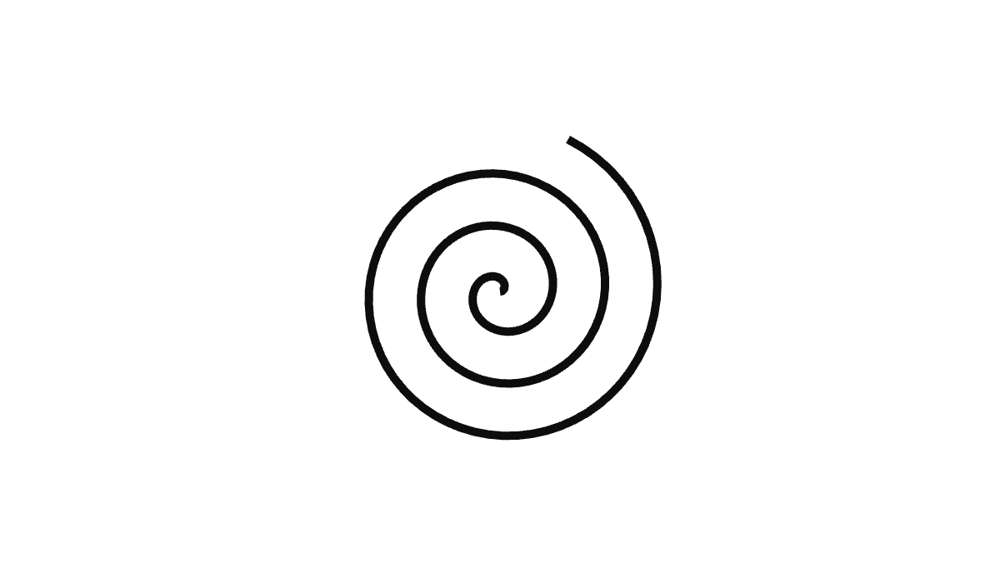

# Example 8 (C8): Sketch with the mouse

*CGP, strokes drawn with the mouse, with keys of the demo that leave the arrow keys to the slides. The page of the
tutorial: [8. Sketch with the mouse](https://scholartools.fr/interactive-3d-slides/02_examples/02_sketch/index.html).*



Strokes drawn with the mouse on a sheet, each one a ribbon (a mesh: WebGL lines are one pixel wide). The demo
has its own keys, and the slide its own buttons, for the same actions.

- **Graphics:** meshes built while the mouse moves.
- **Interface:** direct manipulation, keys of the demo, buttons in the slide.

## In a slide

In reveal.js: [slides.html](slides.html). In lhtml-site: [lhtml-site/](lhtml-site/), the slide
`src/01_sketch/index.html.j2`, with the demo in `src/_demo/`:

```
demo::../_demo/index.html?controls=width,draw&panel=br
```

| Setting | Values | Default |
|---|---|---|
| `color` | `black`, `red`, `blue` | `black` |
| `width` | the width of the next strokes | `0.03` |
| `draw` | `1`: the mouse draws, `0`: it turns the camera | `1` |
| `undo`, `clear` | actions | |
| `strokes` | the number of strokes (read only) | |
| `sample` | `1`: starts with a spiral (the image of the demo in a PDF) | |

## The keys of the demo

| Key | Action |
|---|---|
| Z | undo the last stroke |
| C | clear |
| 1, 2, 3 | black, red, blue |
| D | draw, or turn the camera |

- Use letters and digits. The page of the demo sends the arrow keys and Page Down / Page Up to the slides,
  even after a click in the demo: keep them for the presentation. Avoid the space bar, which some slide tools
  also use.
- On the web, compare the GLFW codes of the keys (`GLFW_KEY_Z`): their names (`glfwGetKeyName`) are not known.
- A value changed from the program (a key) is shown again by the panel and the slide after `slide::notify()`.

## Build

```sh
# from the root of the repository (or of the unzipped folder), the Emscripten SDK active
source <emsdk>/emsdk_env.sh
git clone https://github.com/drohmer/cgp-2027.git ../cgp-2027     # the CGP project, once
CGP_DIR=../cgp-2027 python3 scripts/build_examples.py c8-cgp-sketch
```

The build replaces [web/](web/) and `lhtml-site/src/_demo/`: both slides then show the new version.
Serve the root of the repository (or of the unzipped folder) with a web server, not as a file:
`python3 -m http.server 8080`, then open `http://localhost:8080/examples/c8-cgp-sketch/slides.html`.
