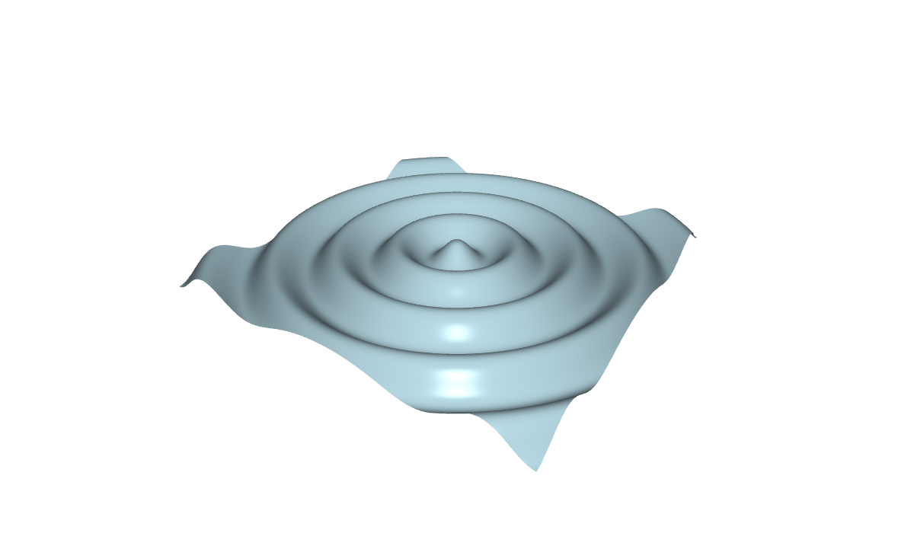

# Example 9 (C9): Two demos side by side

*CGP, the same demo twice in a slide, with two methods, driven by the same slider. The page of the tutorial:
[9. Two demos side by side](https://scholartools.fr/interactive-3d-slides/03_examples/03_compare/index.html).*



A plane deformed in its vertex shader, shown twice: on the left with the exact normals of the deformed
surface, on the right with the normals of the flat plane (the shape is the same, the lighting is wrong). The
slider of the slide sets the amplitude of both.

- **Graphics:** a deformation computed in a vertex shader.
- **Interface:** two frames of one slide, driven together.

## In a slide

Two frames of the same build, which differ by their address (`?normals=exact`, `?normals=plane`). The controls
of the slide name both frames: `data-demo="#left, #right"`.

```html
<iframe class="demo" id="left" data-src="web/index.html?normals=exact"></iframe>
<iframe class="demo" id="right" data-src="web/index.html?normals=plane"></iframe>
<input type="range" data-demo="#left, #right" data-demo-input="ampl" min="0" max="0.15" step="0.005">
<button data-demo="#left, #right" data-demo-set="restart">Restart both</button>
```

In lhtml-site: [lhtml-site/](lhtml-site/), the slide `src/01_compare/index.html.j2`, with the demo in `src/_demo/`.

| Setting | Values | Default |
|---|---|---|
| `normals` | `exact`, `plane` | `exact` |
| `ampl` | the amplitude A | `0.06` |
| `freq` | the frequency k | `20` |
| `play` | the animation runs | `1` |
| `restart` | action: the time back to 0 | |

- Each copy runs its own clock: "Restart both" sets them to the same time.
- Two demos are two WebGL contexts: the browser limits their number in a page (see the page "On the day of
  the talk").

## Build

```sh
# from the root of the repository (or of the unzipped folder), the Emscripten SDK active
source <emsdk>/emsdk_env.sh
git clone https://github.com/drohmer/cgp-2027.git ../cgp-2027     # the CGP project, once
CGP_DIR=../cgp-2027 python3 scripts/build_examples.py c9-cgp-compare
```

The build replaces [web/](web/) and `lhtml-site/src/_demo/`: both slides then show the new version.
Serve the root of the repository (or of the unzipped folder) with a web server, not as a file:
`python3 -m http.server 8080`, then open `http://localhost:8080/examples/c9-cgp-compare/slides.html`.

## Credits

The deformation comes from the CGP example of github.com/drohmer/epita_ani3d_lab_code-2027
(examples/03_shaders/01_deformation).
